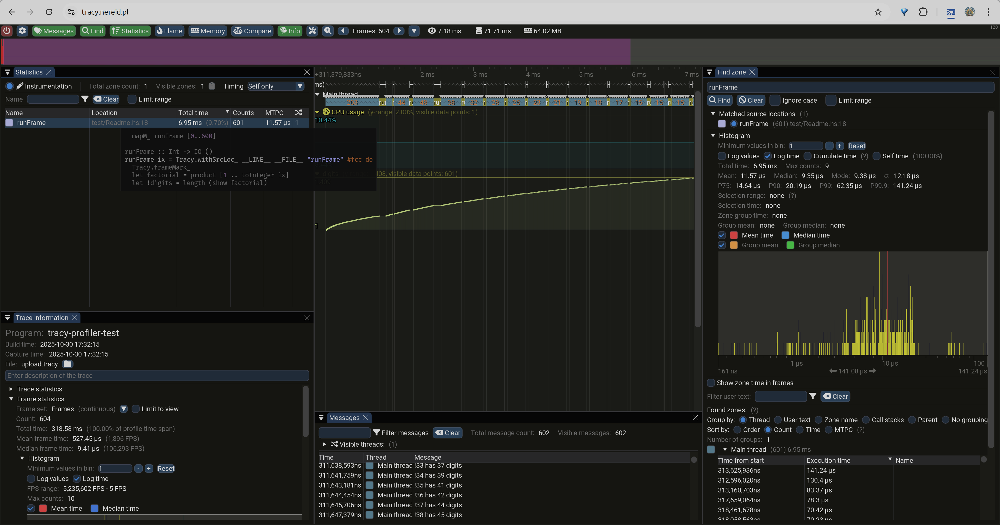

# tracy-profiler

Haskell bindings for [Tracy frame profiler](https://github.com/wolfpld/tracy).

## Setup

### Installing

This version of the bindings targets Tracy 0.15.
The C API changes between releases, so anything older will fail to link or misbehave.

You can install the prebuilt package from your distribution if it ships that release:

```sh
sudo apt install libtracy-dev tracy-capture tracy-profiler
```

Or you can download and build one yourself and point your project to it:

```yaml
# stack.yaml
extra-lib-dirs:
- upstream/_build/library
extra-include-dirs:
- upstream/tracy/public/tracy
```

You can use the provided Makefile that will do the thing:
```sh
make all # fetch and build stuff
make test # run the example
upstream/_build/profiler/tracy-profiler & disown # launch the profiler GUI
```

This way you can customize configuration.
Make sure you update package flags to match.

Either way, you have to ensure that `tracy-capture`/`tracy-profiler` is built with the same version.
Otherwise it will connect and immediately refuse to record anything.

### Flags

The flags must match whatever the library has been built with.

By default all the instrumentation wrappers do nothing.
That means you don't have to `ifdef` your code to remove the wrappers when they're not needed.

You have to set the `enable` flag in your project for the data to be collected.

```yaml
flags:
  tracy-profiler:
    enable: true
    # manual_lifetime: false
    # on_demand: false
    # fibers: false
```

To use on-demand mode, set the `on_demand` flag and link against a library built with `TRACY_ON_DEMAND`.
`make library-on-demand` builds one in `upstream/_build/library-on-demand`, so point `extra-lib-dirs` there.
The flag has to match the library: the C API symbols don't encode that setting, so a mismatch links fine and then misbehaves at runtime.

## Instrumentation

Use the functions from `System.Tracy` and `System.Tracy.Zone` to collect data:

```haskell
{-# LANGUAGE MagicHash #-}         -- "static strings"#
{-# LANGUAGE OverloadedLabels #-}  -- #fuchsia colors
{-# LANGUAGE OverloadedStrings #-} -- "yes"

module Main where

import qualified System.Tracy as Tracy
import qualified Data.Text as Text

main :: IO ()
main = Tracy.withProfiler $ do
  Tracy.waitConnected_       -- wait for the tracy-capture to connect
  Tracy.withSrcLoc "main.nowhereInParticular" #f0fa do
    Tracy.messageL "hi there"# -- static strings require no copying to be logged
    mapM_ runFrame [0..600]

runFrame :: Int -> IO ()
runFrame ix = Tracy.withSrcLoc "runFrame" #fcc do
  Tracy.frameMark_
  let factorial = product [1 .. toInteger ix]
  let !digits = length (show factorial)
  Tracy.message . Text.pack $
    -- runtime strings will require some memcpy'ng around, use sparingly on hot paths
    "!" <> show ix <> " has " <> show digits <> " digits"
  Tracy.plotInt "digits"# digits
```

## Collecting and viewing

Start `tracy-capture` before running the test to avoid empty areas where nothing happens:

```sh
tracy-capture -fo output.tracy &
```

Run the code, then upload the collected data to [the viewer](https://tracy.nereid.pl/).

You'll see something like this:



> Are those are GC pauses we're looking at? 🤔

## RTFM

You really should go read the official [manual](https://github.com/wolfpld/tracy/releases/download/v0.15.0/tracy.pdf).

Yes, BEFORE you run into corrupted memory, surprising grouppings, or otherwise botched profiling runs.
